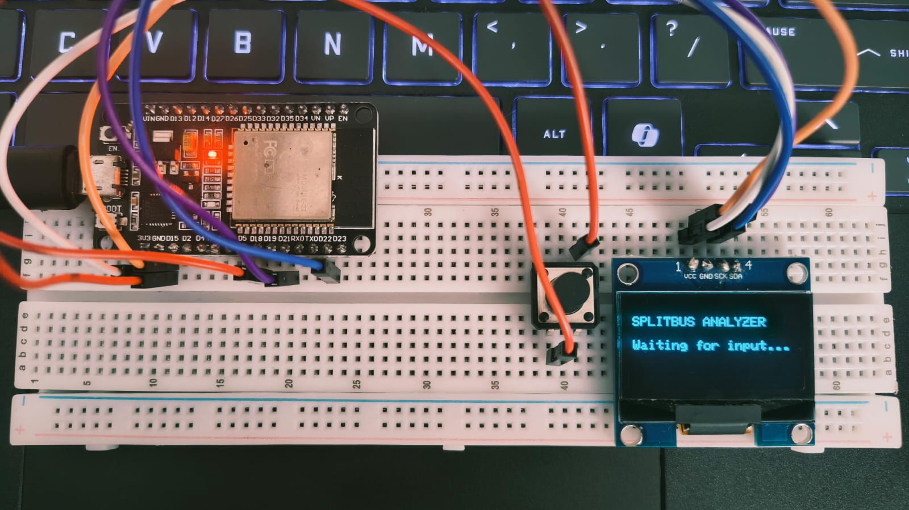
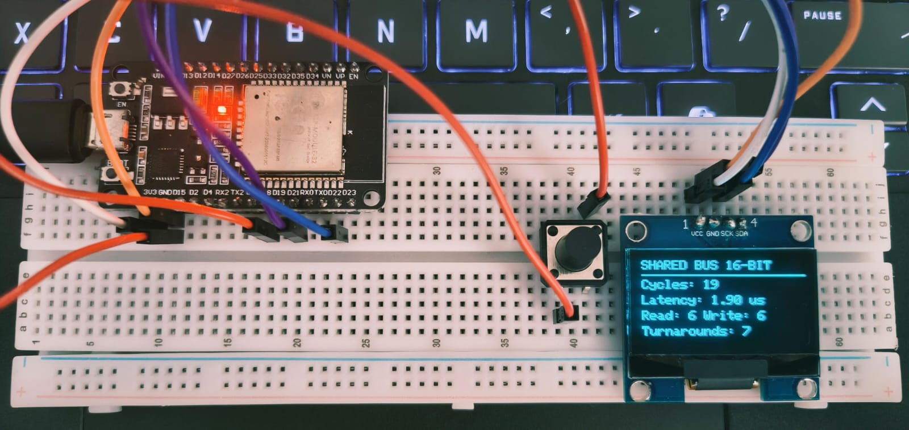
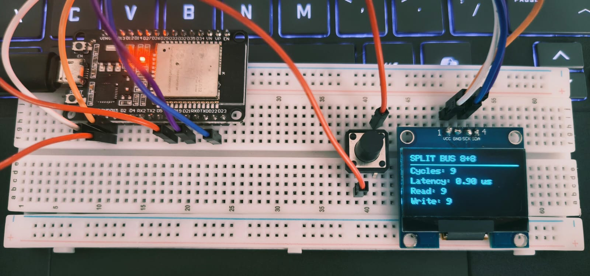
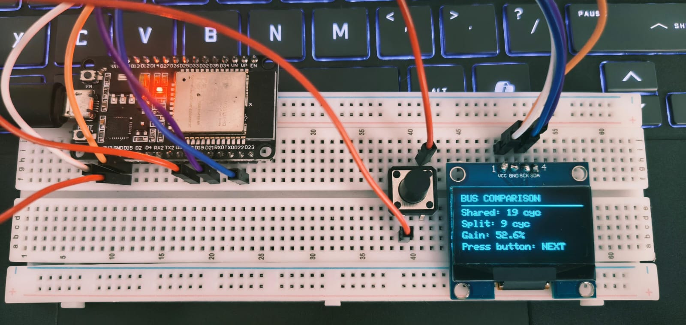
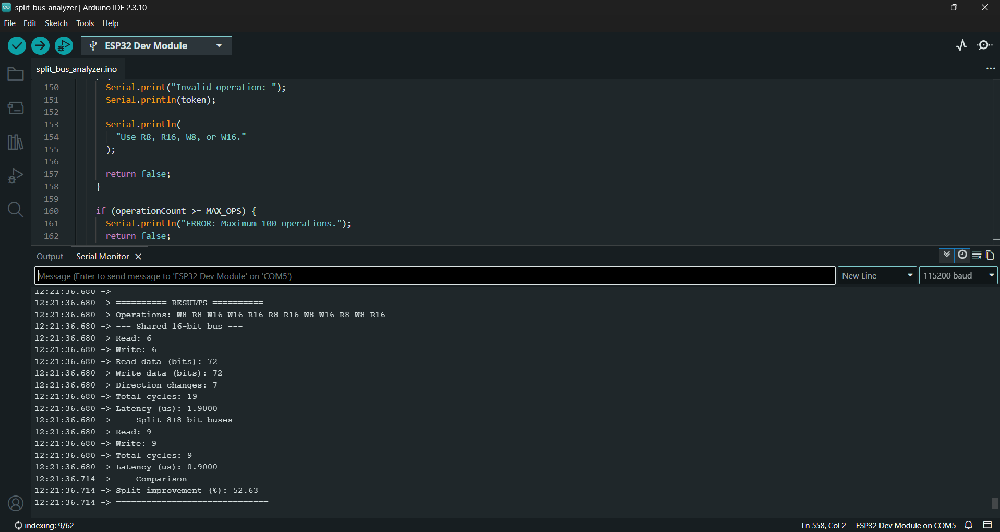

# SplitBus Analyzer

### Shared vs Split Bus Architecture | ESP32-Based Performance Analyzer

**Author:** Mahdi Rifqua

**GitHub:** [@mahdi-medtech](https://github.com/mahdi-medtech)

**Platform:** ESP32

**Language:** Arduino C++

---

## Overview

SplitBus Analyzer is an embedded system developed to study the performance difference between a conventional shared bidirectional bus and an architecture with independent read and write data paths.

The project compares a **16-bit shared bidirectional bus** against **two independent 8-bit buses**, one dedicated to reading and the other to writing.

The objective is to examine how bus direction changes, transfer width and independent read/write scheduling affect the total number of clock cycles and estimated transfer latency.

An ESP32 processes the operation sequence, evaluates both architectures and displays the results through an SH1106 OLED.

## The Problem

In a shared bidirectional bus, read and write operations use the same physical data path.

When consecutive operations require different transfer directions, the bus must change direction. This introduces turnaround overhead.

A split-bus architecture separates the read and write paths, potentially allowing both directions to operate independently.

The central question behind this project:

**How much timing overhead can be avoided by separating read and write data paths?**

## Architecture

The system evaluates two configurations:

### 01. Shared 16-bit Bidirectional Bus

* Single 16-bit data path.
* Supports both read and write operations.
* Each operation is modeled as one clock cycle.
* A direction change introduces one additional turnaround cycle.
* Read and write operations are processed sequentially.

### 02. Split 8+8-bit Architecture

* Dedicated 8-bit read data path.
* Dedicated 8-bit write data path.
* Each 8-bit transfer requires one cycle.
* Each 16-bit transfer requires two cycles.
* Read and write workloads are scheduled independently.
* Total cycles are calculated assuming ideal overlap.

## How It Works

The user enters a sequence of read and write operations through the Arduino Serial Monitor.

Supported commands:

| Command | Operation     |
| ------- | ------------- |
| `R8`    | Read 8 bits   |
| `R16`   | Read 16 bits  |
| `W8`    | Write 8 bits  |
| `W16`   | Write 16 bits |

Example input:

`R8 R16 W8 W16 R16`

The ESP32 parses the sequence and evaluates it under both bus configurations.

The system then calculates:

* Read and write cycles.
* Total transfer cycles.
* Number of direction changes.
* Estimated latency.
* Percentage improvement or degradation.

The results are printed through the Serial Monitor and displayed on the OLED.

## Calculation Methodology

### Shared Bus

The shared bus uses one cycle per operation in the current model.

Every transition between read and write directions adds a turnaround cycle.

**Total cycles:**

`Shared Cycles = Read Operations + Write Operations + Direction Changes × Turnaround Cycles`

### Split Bus

Each independent bus transfers 8 bits per cycle.

Therefore:

* 8-bit operation = 1 cycle.
* 16-bit operation = 2 cycles.

Read and write workloads are calculated independently.

**Total cycles:**

`Split Cycles = MAX(Read Cycles, Write Cycles)`

This represents ideal parallel scheduling, without modeling data dependencies or ordering constraints.

### Latency

The model assumes a fixed bus clock frequency of 10 MHz.

`Latency (µs) = (Total Cycles / Clock Frequency) × 10⁶`

### Performance Improvement

`Improvement (%) = ((Shared Cycles - Split Cycles) / Shared Cycles) × 100`

A positive value indicates fewer modeled cycles for the split architecture. A negative value indicates that the split architecture takes more cycles.

## Hardware Implementation

| Component             | Specification         |
| --------------------- | --------------------- |
| Microcontroller       | ESP32 Dev Module      |
| Display               | SH1106 OLED, 128 × 64 |
| Input                 | Push Button           |
| Communication         | I2C                   |
| Programming Interface | Serial Monitor        |

### Pin Configuration

| Component   | ESP32 GPIO |
| ----------- | ---------- |
| OLED SDA    | GPIO 21    |
| OLED SCL    | GPIO 22    |
| Push Button | GPIO 18    |
| Button GND  | GND        |

The push button uses the ESP32's internal pull-up resistor.

A 40 ms debounce interval is implemented in software to prevent multiple screen transitions from a single button press.

## Display Interface

The OLED contains three display states:

**Screen 1: Shared Bus**

* Total cycles
* Estimated latency
* Read cycles
* Write cycles
* Direction changes

**Screen 2: Split Bus**

* Total cycles
* Estimated latency
* Read cycles
* Write cycles

**Screen 3: Performance Comparison**

* Shared bus cycle count
* Split bus cycle count
* Percentage improvement or degradation

The push button cycles through all three screens.

## Software Details

* Maximum operation sequence: 100 operations.
* Serial baud rate: 115200.
* Bus clock assumption: 10 MHz.
* Turnaround overhead: 1 cycle per direction change.
* OLED I2C address: 0x3C.
* Input validation for supported operation commands.

### Libraries

* Wire
* Adafruit GFX Library
* Adafruit SH110X Library

## Current Scope and Limitations

The present implementation is a software-based architectural timing model running on an ESP32.

The two bus architectures are evaluated mathematically. The ESP32 does not physically implement the separate data buses.

The current model assumes:

* No memory wait states.
* No memory alignment penalties.
* No bus contention in the split architecture.
* Ideal overlap between independent read and write workloads.
* No data dependencies or ordering constraints in split-bus scheduling.

The calculated latency is an estimate based on the assumed clock frequency, not a direct measurement of physical bus transactions.

## Future Development

* RTL implementation of the split-bus architecture.
* Hardware-level read/write arbitration.
* Bus conflict detection and resolution.
* FPGA-based implementation.
* Comparison between modeled and measured timing.
* Evaluation under different clock frequencies and workload patterns.

---

**Project Domain:** Computer Architecture | Embedded Systems | Digital Design | Bus Optimization

**Status:** ESP32-based performance analysis implementation.

---

## Hardware Implementation

The SplitBus Analyzer was prototyped using an ESP32 Dev Module, SH1106 OLED display and push-button interface.

### Hardware Prototype

### OLED Display Outputs

**Shared Bus Analysis**

**Split Bus Analysis**

**Performance Comparison**

### Serial Monitor Results

The Serial Monitor provides detailed cycle calculations, estimated latency and performance comparison for both architectures.

